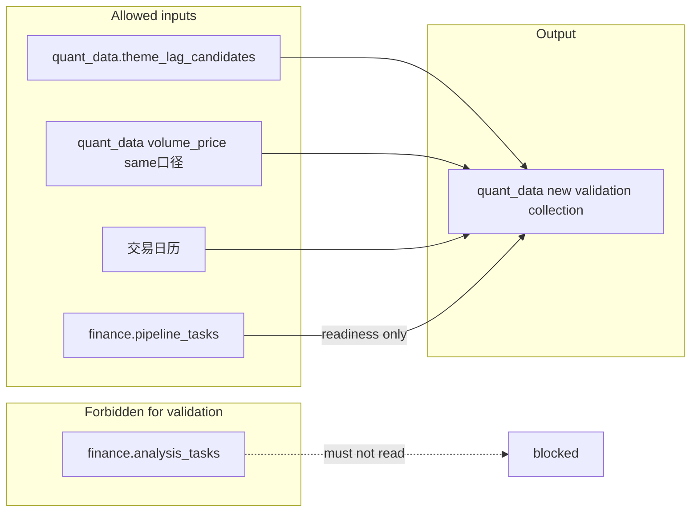

# 主题补涨候选验证（Theme Lag Candidate Validation）— 阶段 0 规格

**版本**: 0.2.1 · **修订日期**: 2026-04-30（review：`有效观察日` 前向引用、空候选默认 A / `--skip-empty` 为 B）

## 背景与需求（评审导读）

### 业务背景

「主题补涨」链路中，`quant_data_engine` 会按业务日生成 **`quant_data.theme_lag_candidates`**（多桶、多标的），并可入队 **`theme_lag_narrative`**（`finance.analysis_tasks`）由 Analyzer 生成可读叙事。**本规格解决的是另一件事**：在推荐所对应的锚定日 \(T\) 之后，用**确定性、可审计**的规则，在有限个交易日内回看标的走势是否符合事先约定的「命中 / 止损 / 期满」语义，并把结果**落库**，供后续 API、看板或研究使用——与 LLM 是否写好叙事**无先后依赖**。

### 为何强调「硬约束：不读 `analysis_tasks`」

- **叙事与参数**在 `analysis_tasks` 中，但验证若依赖其 `params`/`result`，会与队列状态、重跑、解析失败等耦合，**回测与批处理难保证可复现**。
- 候选标的的**权威来源**已是 **`theme_lag_candidates`**（与 [run_theme_lag_candidates](../src/quant_data_engine/tasks/run_theme_lag_candidates.py) 写库一致）；组合层对 **`symbol` 去重** 即可对齐「当日推荐集合」，无需再从叙事 Markdown 解析代码。
- **依赖方向**：叙事任务仍依赖**数据采集 + 候选计算**完成；**验证只依赖 `quant_data` + 日线就绪门闩**，不等待叙事 `completed`。

### 产品与市场口径假设

- 系统**无实时行情**，故全程**仅日收盘价**；曾讨论过的「首次触及价」已按此约束**收缩为**：在**有效观察日**（定义见 **§4**：某一交易所开市日内该股存在有效收盘，并据此产生一根可参与 §5 判定的观察根）上按**收盘**判断是否触及 ±3% 带。
- **假设**推荐当日收盘可视为建仓参考价 \(P_0\)（见 §3、§5）；**不**在本期讨论佣金、**执行滑点**、竞价跳空等执行细节（列入 §9）。
- **权限**：验证结果拟作为**非个人私密**数据；**读**仍由产品侧「是否开通主题补涨能力」的 **entitlements** 控制（见 §8）。未来若挂任务中心，写入侧可用 **`user_id = system`** 表示系统任务。

### 与流水线元数据的关系

采集/计算任务在 `finance.pipeline_tasks`（及 `job_status`）中已有按 `task_type` + 业务日的完成记录。验证脚本**只读**该集合做**就绪判断**，不把 `analysis_tasks` 纳入依赖图；长期可将纯计算类步骤与 `data_collection` 在 `domain` 上区分（见 §7）。

### 数据流（允许 / 禁止）



### 评审时可重点把关的问题

- **顺延 §4 / §4.1**：「10 个交易日」名额与停牌的关系是否满足业务对**最长观察窗口**的预期；停牌密集时 `insufficient_data` 占比是否可接受。
- **§5**：仅日收盘时 ±3% 两带**数学上不可同日兼得**；若未来改为日内序列，见 §5 末「扩展约定」。
- **§5.5**：聚合 MVP 为**建议默认**，实现前可再评审调整。
- **§6 唯一键与重跑**：每条 `(anchor_trade_date, index_store_key)` 一条文档；`eval_completed_at` 语义见 §6.1。
- **§7.1**：日终触发与重试的具体时刻、与上游 `stock_daily` 的先后，由运维与实现按环境变量落地。

## 1. 目标

在**不依赖 LLM、不读 `analysis_tasks`** 的前提下，对 **`quant_data.theme_lag_candidates`** 在某一锚定业务日、某一指数下的推荐标的集合，按约定规则用与 **`volume_price` 一致口径的日收盘价**，在 **\(T\) 之后至多 10 个交易所开市日**（见 §4、§4.1）内，按 §5 **流式**读取有效收盘并判定止盈/止损/期满；若名额用尽时仍 **\< 3** 根有效收盘则 **`insufficient_data`**；将结果写入 **`quant_data.theme_lag_candidate_validation`**（见 §6）。

## 2. 硬约束

- **禁止**：验证流水线（日终脚本、回测、指标落库）读取或依赖 **`finance.analysis_tasks`**（含状态、`params`、`result`、Markdown 等）参与任何收益、命中、止损、出场价或标的集合的推导。
- **允许**：**`quant_data.theme_lag_candidates`**、与 **`volume_price` 同源同口径的日 K**、**交易日历**、**`finance.pipeline_tasks`**（仅作前置数据集就绪门闩，不参与价格计算）。
- **叙事**：`theme_lag_narrative` 仍依赖数据采集与计算完成；**验证不等待**叙事完成。

## 3. 基准日与标的

- **`anchor_trade_date`**：与 **`theme_lag_candidates.trade_date`** 一致（记为 \(T\)）。
- **`index_store_key`**：与候选表一致。
- **\(P_0\)**：**\(T\)** 日该股**收盘价**，与 **`volume_price`** 一致。
- **组合标的**：同一 `(anchor_trade_date, index_store_key)` 下，对 **`symbol` 去重**（跨桶重复只计一只）。

### §3.1 空候选（无标的）

若给定 `(anchor_trade_date, index_store_key)` 在 **`theme_lag_candidates`** 中去重后 **标的数为 0**：

- **默认（策略 A）**：仍 **`upsert` 一条**主文档（自然键不变），建议字段如 `symbols_count: 0`、`per_symbol: []`、聚合占位、`run_status: empty_universe`（或等价枚举名由实现定），并写入 **`eval_completed_at`**，以便与「尚未跑验证」区分。
- **策略 B（可选）**：实现若提供 **`--skip-empty`**，则**不写库**，仅打日志后退出（成功码）；适用于批量日终、希望减少无意义文档时。

## 4. 交易日、停牌与顺延

- 自 **\(T\) 的下一交易所开市日**起，仅使用**收盘价**；某日该股**无有效收盘**则该日**不产生有效观察根**，但**仍消耗 §4.1 所述的一个「开市日名额」**（见下）。
- **观察根数与结束**：在 §4.1 的 **10 个开市日名额**内，每出现一根有效收盘即按 §5 判定是否结束；若名额用尽时累计有效收盘 **\< 3**，则 **`insufficient_data`**。
- **`insufficient_data` 与「最少几根」**：**0、1、2 根**有效收盘在窗口结束时均视为**不足以**完成 §5 的完整路径（需 3 根才能「期满」分支），一律记 **`insufficient_data`**；**不设**「至少 1 根才记 insufficient」的额外门槛。
- **「10」**：默认 **10**；实现阶段可用环境变量覆盖（见 §4.1）。

### §4.1 「至多 10 个交易日」计数（消除歧义）

**含义（选 A：仅计交易所开市日，不计自然日墙钟）**：

- 令 \(d_1\) = \(T\) 的**下一开市日**，\(d_2\) 为 \(d_1\) 的下一开市日，依此类推。周末、长假等**非开市日不参与计数、也不占位**。
- 验证脚本对 \(d_1 \ldots d_{10}\) 逐个开市日迭代；每遇到一根有效收盘，**有效观察根数 +1**，并立即按 §5 判断是否结束（可提前退出循环）。
- 若 **10 个开市日迭代已结束**（未因止盈/止损/期满提前退出）且有效观察根数仍 **\< 3**，则 **`insufficient_data`**。
- **不是**：「自然流逝 10 个日历日」；**不是**：把周末算作 10 的一部分。

**示例**（仅说明计数，非价格规则）：

- \(T=\) 周五 → \(d_1=\) 下周一、\(d_2=\) 下周二、\(d_3=\) 下周三…（周末不占 10 的名额）。
- 若该股在 \(d_1\)、\(d_2\) 有收盘、\(d_3\) 起长期停牌直至 \(d_{10}\) 仍无收盘，则有效根数 = 2 → **`insufficient_data`**。

**伪代码（单 symbol，与 §5 流式一致）**：

```text
valid_count = 0
for i in 1..10:
    d = i_th_trading_day_after(T, i)   # i=1 为 T 的下一开市日；周末不占 i
    c = load_close(symbol, d)
    if c is None:
        continue                       # 无有效收盘，不增加 valid_count
    valid_count += 1
    if c >= 1.03 * P0: exit_take_profit(c); return
    if c <= 0.97 * P0: exit_stop_loss(c); return
    if valid_count == 3: exit_expire(c); return   # 期满
# 10 个开市日名额用尽
if valid_count < 3: status = insufficient_data
```

（若需写入 `eod_float_path`，可在每一根有效 `c` 上追加盯市点，与是否提前结束无关。）

## 5. 出场规则（仅收盘）

对每个 `symbol`，自 \(d_1\) 起在 §4.1 的 **10 个开市日名额**内**按时间顺序**扫描；每遇到一根**新的有效收盘** \(C_d\)（相对已确定的 \(P_0\)），**立即**按下述顺序判定是否**结束**该 symbol 的验证（**流式**，而非「先凑满 3 根再算」——否则无法表达「第 1 根有效收盘即止盈」）：

1. **止盈**：若 \(C_d \ge 1.03 \cdot P_0\)，出场价 \(= C_d\)，结束。
2. **止损**：若未触发 1 且 \(C_d \le 0.97 \cdot P_0\)，出场价 \(= C_d\)，结束。
3. **期满**：若当前这根是**第 3 根**有效收盘，且未触发 1、2，则出场价 \(= C_d\)（期满），结束。
4. 若未触发 1–3：继续 §4.1 循环中的**下一开市日**。
5. 若 §4.1 中 **10 个开市日已全部遍历**仍未触发 1–3，且累计有效收盘 **\< 3**：**`insufficient_data`**。
6. **单只收益率**（在已因 1–3 正常结束时）：\((\text{出场价} - P_0) / P_0\)。

**同日两带（仅日频收盘）**：对固定 \(P_0\)，不存在同一 \(C_d\) 同时满足 \(C_d \ge 1.03P_0\) 与 \(C_d \le 0.97P_0\)。**若未来扩展为日内序列**且同日先跌穿止损带再涨穿止盈带，则**以时间先后扫描**；与本条 1→2 顺序一致，**先止盈判定再止损判定**（日内粒度须另行成文）。

**数值示例（期满路径，与 review 一致 spirit）**：\(T=\) 2026-04-28，\(P_0=10.00\)；有效收盘依次为 10.20（+2%）、10.40（+4%）、10.50（+5%），均未触发 ±3% 带 → 第 3 根期满出场 10.50，收益率 **+5%**。（若第 2 根已为 10.35≥10.30，则第 2 根即止盈，不再看第 3 根。）

### §5.5 聚合层（MVP 建议默认，实现前可再评审）

以下为 **MVP 建议**，写入实现 schema 时可调整；评审意见希望先有占位。

| 指标 | 定义（MVP 建议） | `insufficient_data` |
|------|------------------|---------------------|
| **命中率（止盈占比）** | 止盈出场标的数 / **有完整 §5 判定结果**的标的数 | **分母、分子均排除** `insufficient_data` |
| **止损率** | 止损出场数 / 同上分母 | 同上 |
| **期满占比** | 期满出场数 / 同上分母 | 同上 |
| **中位数（或均值）收益率** | 对**有完整结果**的标的的已实现收益率取中位数 | **排除** `insufficient_data`；可选另字段统计「含 insufficient 记为 null」的敏感性分析（非 MVP） |

**等权**：组合层默认各 `symbol` **等权**（与去重后列表一致）；不按桶加权（除非后续产品另定）。

## 6. 落库

- **库**：**`quant_data`**，集合名 **`theme_lag_candidate_validation`**（已实现；见 `ThemeLagCandidateValidationRepository`）。
- **唯一键（自然键）**：**`(anchor_trade_date, index_store_key)`**，一条主文档。
- **建议非键字段**：`eval_completed_at`（语义见 §6.1）；`last_close_trade_date_included`；可选 **`eod_float_path`**；`per_symbol` 明细 MVP 可后补。

### §6.1 重跑（re-run）语义

- **识别**：同一 `(anchor_trade_date, index_store_key)` 再次执行视为**重跑**，与「新锚点」无关。
- **写入**：推荐 **`replace_one` + `upsert=True`**（或等价**整文档替换**），保证同一自然键下**单次重跑结果原子覆盖**，避免半写入混合新旧字段。
- **`eval_completed_at`**：**每次**成功完成计算并写库时，更新为**本次运行**的 UTC 完成时间（重跑会刷新该时间戳）。
- **部分失败**：若组合内部分 symbol 失败策略在实现时定义，不应留下「旧 per_symbol + 新聚合」长期不一致；要么事务性批量写（若栈支持），要么先写临时键再 swap（实现阶段定）。

## 7. 流水线依赖（实现阶段）

- 脚本启动时查 **`finance.pipeline_tasks`**：约定 `task_type`（如 **`stock_daily`**、**`theme_lag_candidates`**）在**所依赖的 `date`** 上为 **`complete`** 再计算；未齐则**退出**（建议 **exit code 0** + 明确日志 `not_ready`，避免与硬错误混淆），由**调度在下一周期重试**。
- **`domain`**：长期建议区分 `data_collection` 与 `data_calculation`；与现有 `record_ingestion_run`（`quant_data_engine/utils/ingestion_job.py`）的衔接在实现时定。

### §7.1 日终触发与重试（建议默认，可由环境变量覆盖）

以下**非强约束**，供运维与实现对齐；评审希望先有可讨论默认值。

| 项 | 建议默认 |
|----|----------|
| **触发条件** | 依赖的 `pipeline_tasks`（至少 **`stock_daily`** 与 **`theme_lag_candidates`** 在相关 `date` 上为 `complete`）已满足后再启动验证脚本 |
| **相对上游的缓冲** | 在 `stock_daily` 标记 `complete` 之后，建议 **≥ 5 分钟** 再跑验证（避免读写竞态；具体视采集写入延迟调整） |
| **重试** | `not_ready`：由 cron/调度**下一周期**自然重试，不设固定次数上限亦可；若需主动重试：**最多 3 次**、指数退避（如 2min / 5min / 10min）为合理起点 |
| **单次运行超时** | 全表/全日批量验证建议单次作业 **30～120 分钟** 上限 + 监控告警（与数据量相关，实现时配置） |

## 8. 权限（后续 API/UI）

- 验证结果非个人私密；若未来挂任务中心可用 **`user_id = system`**；**读权限**与「主题补涨」功能 **entitlements** 一致。

## 9. 非本期范围

- 验证完成后的 **LLM 解读**再入队 `analysis_tasks`。
- 手续费、**执行滑点**、相对指数超额、竞价跳空等执行层细节。
- 日内路径、除权除息事件对 \(P_0\) 的追溯调整（当前与 `volume_price` 现成字段对齐即可）。

## 10. 评审检查清单

- [ ] `theme_lag_candidate_validation` **索引**与字段演进（随 per_symbol 体量评审）。
- [ ] §3.1 **空候选**：默认 A 与 `--skip-empty`（B）是否与运维/面板预期一致。
- [ ] `insufficient_data`：§4 与 §5.5 是否与产品对「无结果标的」展示一致。
- [ ] 日终与 `pipeline_tasks` 触发顺序、§7.1 默认值在运维侧是否可执行。
- [ ] 重跑与 `eval_completed_at`（§6.1）是否满足审计需求。
